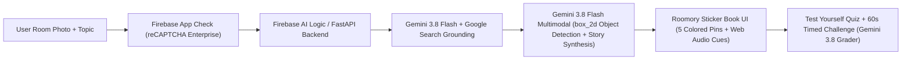

# Roomory — There’s always room to remember.
**Google Cloud AI Builder Cup 2026 Submission** · **Track:** Media, Content & Digital Experiences (Accelerated Learning)

- **Live Deployed Prototype (Firebase Hosting):** https://spatial-memory-ai-loci-849b3.web.app
- **Public GitHub Repository:** https://github.com/zurvaaziz56/spatial-memory-ai

---

## What is Roomory?
**Roomory** turns any photo of your room or desk into an interactive **Sticker Book Memory Palace** (the *Method of Loci*).

Instead of memorizing dry lists or plain flashcards that fade after a few minutes, you snap a photo of a familiar space, tell Roomory what you want to remember (e.g., *Everyday Spanish Words*, *Solar System Planets*, or a *Weekend Taco Night Shopping List*), and Roomory attaches 5 items to 5 real objects in your room using vivid mini-stories, stereo sound cues, and an interactive quiz.

### Key Features
1. **3-Screen Guided Flow (`1. Start → 2. Your Room → 3. Test Yourself`):**
   - **Start:** Jump right in with 3 photographed sample rooms (*Everyday Spanish Words*, *Solar System Planets*, *Weekend Taco Night List*) or upload your own room photo.
   - **Your Room:** Tap through 5 colored sticker pins (`#FFD93D`, `#8EEBC8`, `#FFA8CB`, `#C4B2FF`, `#FF9A5C`) to collect all 5 stickers (`1 of 5 collected`), read each speech-bubble story, and hear spatial stereo audio cues.
   - **Test Yourself:** View your room photo with the active sticker pin enlarged and tilted, type what you remember in plain English, and optionally turn on the **60-Second Timed Challenge**.
2. **Multimodal 2D Spatial Object Detection (`box_2d`):** Uses `gemini-3.8-flash` to detect 5 distinct physical objects from left to right (`[ymin, xmin, ymax, xmax]`) in any uploaded room photo.
3. **Google Search Grounding:** Enriches study topics with grounded facts and displays verified source links when returned by Google Search.
4. **Resilient Semantic Recall Grader:** Grades free-text quiz answers by meaning using `gemini-3.8-flash` with a strict 20-second timeout and an automatic offline fallback grader.
5. **Firebase App Check Protected:** Secured in production with **Firebase App Check (`ReCaptchaEnterpriseProvider`)** alongside **Firebase AI Logic** and **Firebase Hosting**.

---

## System Architecture



---

## Quickstart

### Option A: Live Firebase Hosting + Firebase AI Logic
The production web app is deployed on **Firebase Hosting** (`spatial-memory-ai-loci-849b3`):
```bash
firebase deploy --only hosting --project spatial-memory-ai-loci-849b3
```

### Option B: Run Locally with FastAPI (`uvicorn`)
```bash
python3 -m venv .venv
source .venv/bin/activate
pip install -r requirements.txt
export GEMINI_API_KEY="your-api-key"
uvicorn main:app --reload --port 8080
```
