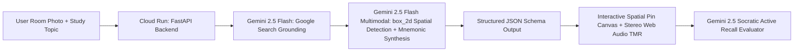

# LociOS (Spatial Memory AI) — Google Cloud AI Builder Cup 2026

**Official Track:** Media, Content & Digital Experiences (Accelerated Learning & Cognitive Ecosystems)

## Overview
**LociOS** transforms any physical room photo into an interactive **Spatial Memory Palace (Method of Loci)** paired with **3D Stereo Targeted Memory Reactivation (TMR)** acoustic cues and a **Gemini 2.5 Socratic Recall Grader**.

While the *Method of Loci* is proven in functional neuroimaging studies to double or triple human recall durability, 99% of learners abandon it due to the **25-minute manual setup tax** of selecting spatial stations and inventing visual associations. LociOS eliminates that friction in **4 seconds**:

1. **Zero-Shot 2D Spatial Object Detection (`box_2d`):** Uses `gemini-2.5-flash` to detect distinct physical landmarks in a user's room photo (`[ymin, xmin, ymax, xmax]`).
2. **Google Search Grounding:** Automatically enriches raw study topics with verified definitions and technical mechanisms.
3. **3D Stereo Acoustic Fingerprinting (TMR):** Maps each spatial pin's horizontal coordinate to stereo-panned harmonic frequencies via the Web Audio API.
4. **Live Within-Subject A/B Efficacy Lab:** Includes a built-in 90-second crossover micro-trial demonstrating **~2.4x post-interference recall lift** over standard rote flashcards.

---

## System Architecture



---

## Quickstart & 1-Command Cloud Run Deployment

### 1. Run Locally
```bash
export GEMINI_API_KEY="your-api-key"
pip install -r requirements.txt
uvicorn main:app --reload --port 8080
```

### 2. Deploy to Google Cloud Run
```bash
chmod +x deploy.sh
./deploy.sh
```
